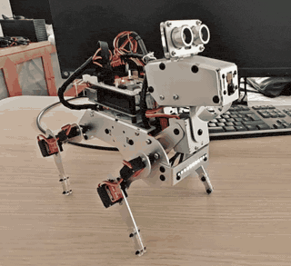
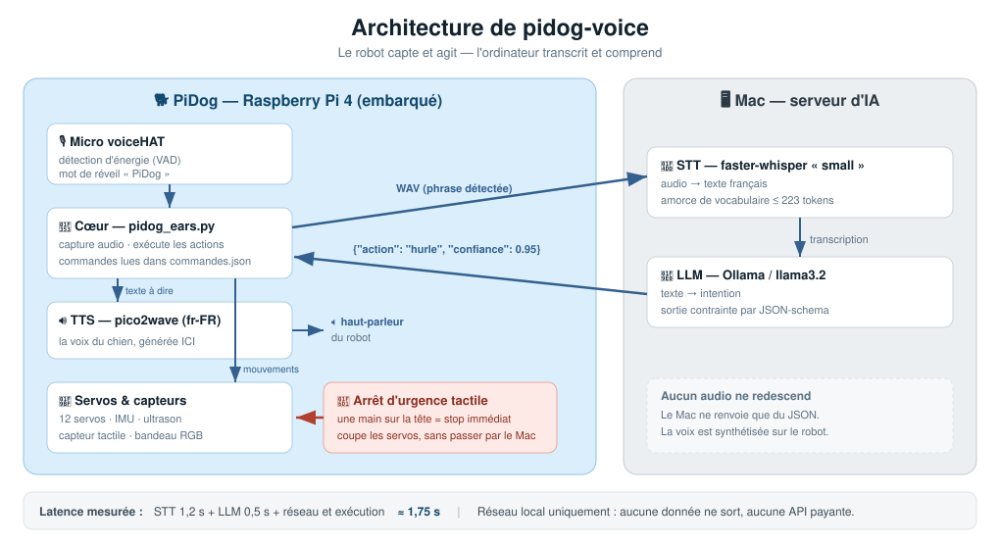
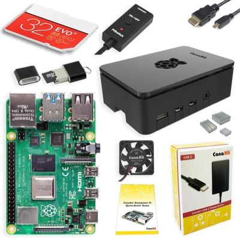
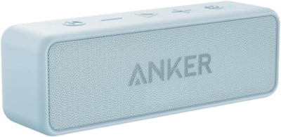

# 🐕 pidog-voice

<p align="center">🇺🇸 <b>English</b> · 🇫🇷 <a href="README.fr.md">Français</a></p>

**French voice control for the SunFounder PiDog robot dog.**
The microphone is on the robot, the brain is on your computer.

Talk to the dog, it obeys: *« PiDog, fais le loup »* (howl like a wolf), *« PiDog, donne la patte »* (give me your paw),
*« PiDog, son plus fort »* (louder). Everything runs **locally** — no data is sent
to the cloud, no paid API.

**Adding a command = editing a JSON file.** No code to write.

> 🇫🇷 The dog understands **French** out of the box (Whisper + LLM prompt + `pico2wave` voice). The pipeline itself is language-agnostic: everything you say to it lives in `commandes.json`.

<p align="center">
  <br>
  <sub><a href="assets/demo.mp4">▶ Watch the video with sound</a></sub>
</p>

---

## How it works

<p align="center">
  
</p>

The robot listens and acts; the computer transcribes and understands. Between the two, **JSON
only**: audio only travels robot → Mac. The dog's voice is
synthesized on the Pi (`pico2wave`), never sent over the network.

**~1.75 s** between the end of your sentence and the first movement.

### Why the brain isn't on the robot

That's the first question people ask. We measured it:

| | transcribing one sentence | load | temperature |
|---|---|---|---|
| Mac Mini M2 Pro | **0.34 s** | — | — |
| Raspberry Pi 4 (`tiny`) | 2.9 s | **7.7** (4 cores) | **76 °C** |
| Raspberry Pi 4 (`base`) | 5.4 s | — | — |

On the Pi, Whisper hogs all 4 cores: the listening loop starves, the robot
**literally stops hearing**, and the audio crackles. Local mode still exists
(`PIDOG_STT=local`) as an offline fallback.

---

## Installation

### On the computer (the brain)

```bash
pip install faster-whisper
ollama pull llama3.2                 # https://ollama.com
python3 mac/stt_server.py            # listens on port 8770
```

### On the Raspberry Pi (the robot)

Requirement: the [SunFounder PiDog](https://github.com/sunfounder/pidog) library installed.

```bash
scp -r commandes.json config.py pi/ demos/ outils/ pidog@<robot-ip>:~/pidog-voice/
ssh pidog@<robot-ip>
export PIDOG_MAC=http://<your-computer-ip>:8770
~/pidog-voice/pi/ears_loop.sh        # supervised listening
```

### Automatic start

```bash
./install/mac_autostart.sh          # Mac: LaunchAgent (a dedicated venv is created along the way)
PIDOG_MAC=http://192.168.1.26:8770 PIDOG_MARCHE=1 ./install/pi_autostart.sh   # Pi: cron @reboot
```

Add `--retirer` to either one to uninstall. The Mac restarts the server if it dies
(`KeepAlive`), the Pi relies on `ears_loop.sh`, which already supervises listening.

> **macOS**: don't put the project in `~/Documents`, `~/Desktop` or `~/Downloads`.
> TCC protection forbids services started by `launchd` from accessing them — the server
> can't even read its own venv (`Operation not permitted`). `~/pidog-voice` is fine.

> **Raspberry Pi**: `cron` rather than systemd, so no root privileges are needed.
> The `--boot` option waits for PipeWire and the network to be ready before starting.

---

## 🛑 Emergency stop

**Put your hand on the dog's head: it stops immediately.**

The touch sensor is the only reliable way to stop it while it's moving, and it is
active as soon as a command moves the robot. Voice isn't enough:

- it goes through the network and Whisper — **1.2 s at best**;
- moving servos make noise **42× louder** than silence and drown out
  speech (measured: 35 at rest, 1513 while moving);
- Whisper can loop on noise — observed, **39 s of transcription**
  during which the robot is completely deaf.

Touch, on the other hand, is local, instant, and depends on nothing.

---

## Adding a command

Everything happens in **`commandes.json`**, and nowhere else. This file feeds all three
stages at once: Whisper's vocabulary, the LLM prompt, and the movements.

```json
"gratte": {
  "intention": "se gratter l'oreille, avoir des puces, se démanger",
  "phrases":   ["PiDog gratte-toi"],
  "exemples":  ["tu as des puces", "gratte toi l'oreille"],
  "reponse":   "Aaah ça fait du bien !",
  "sequence":  [{"preset": "scratch"}]
}
```

That's all. The dog now understands *« tu as des puces »* ("you've got fleas").

| field | role |
|---|---|
| `intention` | describes the action to the LLM — **this field is what drives accuracy** |
| `phrases` | steers Whisper towards the expected wording |
| `exemples` | LLM few-shot examples, for indirect phrasings |
| `sequence` | the movements (see the verbs below) |
| `deplace` | `true` = refused while the robot is on a table |

### Sequence verbs

```json
{"action": "sit", "speed": 70}                  do_action() from the pidog lib
{"preset": "hand_shake"}                        pidog.preset_actions
{"son": "single_bark_1"}                        a sound from ~/pidog/sounds
{"led": {"mode":"breath","color":"cyan"}}       RGB strip
{"tete": [0, 0, -20], "speed": 80}              head movement
{"pattes": [45,-25,-45,25,80,70,-80,-70]}       leg pose
{"pause": 0.5}                                  wait
{"dire": "texte"}                               speech synthesis
{"repeter": 3, "etapes": [...]}                 loop
{"builtin": "distance"}                         Python behaviour
```

**Always validate before deploying:**

```bash
python3 outils/verifier_config.py --tokens
```

> ⚠️ Whisper truncates its vocabulary prompt to **223 tokens, keeping the end**.
> A file that's too wordy therefore makes the *first* commands disappear — silently,
> with no error. That's exactly what this validator catches.

---

## The bundled commands

This table is **generated from `commandes.json`** (`python3 outils/lister_commandes.py
--injecter`), so it can't lie about what the robot can do. The commands are spoken in French.

<!-- COMMANDES:debut -->
| Commande | Ce qu'il fait | Dites par exemple |
|---|---|---|
| `demo` | Jouer le spectacle complet | *« PiDog fais une demo »*, *« PiDog montre tes talents »*, *« pidog fais une demo »* |
| `patrouille` 🔒 | Partir explorer | *« PiDog patrouille »*, *« PiDog pars en ronde »* |
| `assis` | S'asseoir | *« PiDog assis »*, *« assieds toi »* |
| `debout` | Se lever | *« PiDog debout »* |
| `couche` | Se coucher | *« PiDog couche-toi »* |
| `aboie` | Aboyer | *« PiDog aboie »* |
| `hurle` | Hurler a la lune | *« PiDog hurle »*, *« PiDog fais le loup »*, *« fais le loup »* |
| `patte` | Donner la patte | *« PiDog donne la patte »* |
| `pompes` | Faire des pompes | *« PiDog fais des pompes »* |
| `danse` | Danser | *« PiDog danse »*, *« PiDog bouge ton corps »*, *« bouge ton corps »* |
| `gratte` | Se gratter l'oreille avec la patte arriere | *« PiDog gratte-toi »*, *« tu as des puces »* |
| `dodo` | Aller dormir | *« PiDog va dormir »*, *« PiDog bonne nuit »* |
| `stop` | Arreter immediatement | *« PiDog stop »*, *« PiDog arrete-toi »* |
| `distance` | Mesurer ou annoncer la distance de l'obstacle devant lui | *« PiDog qu'est-ce que tu as devant toi »*, *« y a quoi devant toi »* |
| `son_plus` | Monter le volume | *« PiDog son plus fort »*, *« PiDog augmente le son »*, *« pidog son plus fort »* |
| `son_moins` | Baisser le volume | *« PiDog son moins fort »*, *« PiDog baisse le son »*, *« pidog son moins fort »* |

🔒 = déplace le robot : refusé tant que `PIDOG_MARCHE=1` n'est pas défini (il est probablement sur une table).
<!-- COMMANDES:fin -->

(🔒 = moves the robot: refused until `PIDOG_MARCHE=1` is set — it's probably on a table.)

The dog accepts far more phrasings than these: the LLM interprets the
intent. *« montre-moi ce que tu sais faire »* (show me what you can do), *« tu as des puces ? »* or
*« on ne t'entend pas »* (we can't hear you) work without being listed anywhere.

### Renaming the robot

The name runs through all three stages (wake word, Whisper prompt, LLM prompt).
It fits in a single setting:

```json
"reglages": {
  "nom": "Rex",
  "variantes_reveil": ["rexe", "raiks", "rek"]
}
```

The commands' `phrases` use the `{nom}` marker, substituted at load time —
nothing else to change. Remember to **rewrite `variantes_reveil`**: these are the
distortions speech recognition applies to the name, and the ones for "PiDog"
obviously don't apply to "Rex". The name itself is added automatically.

## 🚨 Safety: the robot is often on a table

Any command marked `"deplace": true` is **refused** — the dog answers that it can't,
rather than falling off the table. To allow it once it's on the floor:

```bash
PIDOG_MARCHE=1 ~/pidog-voice/pi/ears_loop.sh
```

## Settings

| variable | default | role |
|---|---|---|
| `PIDOG_MAC` | `http://cerveau.local:8770` | address of the brain |
| `PIDOG_WHISPER` | `small` | `base` = 3× faster, less robust |
| `PIDOG_MARCHE` | `0` | `1` allows moving around |
| `PIDOG_VOLUME` | *(unchanged)* | PipeWire volume in % |
| `PIDOG_STT` | `mac` | `local` = Whisper on the Pi (slow) |

---

## Pitfalls we hit (so you don't have to)

- **The microphone**: use the ALSA device `plug:mic` or `robothat`. `default` and `hw:`
  are **silent** — the softvol gain isn't applied to them.
- **The volume**: if the dog can't be heard, it's probably neither ALSA nor the sound
  files, but **PipeWire**, which often starts at 40% (−24 dB).
  `pactl set-sink-volume @DEFAULT_SINK@ 100%`. Don't go above 100%: it crackles.
  By the way, `robot_hat.music_set_volume()` **does nothing** — it calls
  `sudo amixer sset 'PCM'`, and that control doesn't exist on this card.
- **The wake word is essential**: without it, the LLM invents an action from an
  ordinary sentence of conversation, with a confidence of 0.8. A threshold filters nothing.
- **Whisper doesn't know "PiDog"** and transcribes it as "qui doit" or "le pideau".
  The `phrases` field fixes that — measured: 0/5 → 5/5.
- **Quality comes from the prompt, not the model size.** Describing each action and
  giving examples took llama3.2 from 75% to 93% — better than a model twice
  as big with a poor prompt, and twice as fast.

---

## 🤝 Project hardware

*Amazon affiliate links: if you buy through these links, the project earns a small commission at no extra cost to you.*

<table>
<tr>
<td align="center" width="33%">
  <a href="https://www.amazon.com/dp/B07V5JTMV9?linkCode=ll2&amp;tag=koua29pvoice-20&amp;ref_=as_li_ss_tl"></a><br>
  <b><a href="https://www.amazon.com/dp/B07V5JTMV9?linkCode=ll2&amp;tag=koua29pvoice-20&amp;ref_=as_li_ss_tl">CanaKit Raspberry Pi 4 (4 GB)</a></b><br><sub>Kit with the board that runs inside the dog</sub>
</td>
<td align="center" width="33%">
  <a href="https://www.amazon.com/dp/B0B7NVMBPL?linkCode=ll2&amp;tag=koua29pvoice-20&amp;ref_=as_li_ss_tl"></a><br>
  <b><a href="https://www.amazon.com/dp/B0B7NVMBPL?linkCode=ll2&amp;tag=koua29pvoice-20&amp;ref_=as_li_ss_tl">SanDisk 64 GB microSD (2-pack)</a></b><br><sub>Raspberry Pi OS and the project files</sub>
</td>
<td align="center" width="33%">
  <a href="https://www.amazon.com/dp/B0FLD69KFF?linkCode=ll2&amp;tag=koua29pvoice-20&amp;ref_=as_li_ss_tl"></a><br>
  <b><a href="https://www.amazon.com/dp/B0FLD69KFF?linkCode=ll2&amp;tag=koua29pvoice-20&amp;ref_=as_li_ss_tl">Anker Soundcore 2 (Bluetooth speaker)</a></b><br><sub>The music the dog listens to, and its replies</sub>
</td>
</tr>
</table>

<sub>As an Amazon Associate I earn from qualifying purchases.</sub>

## ☕ Buy me a coffee

This project is free and open source. If you find it useful, you can say thanks
by buying me a coffee — just scan this PayPal QR code. Thanks a lot! 🙏

<p align="center">
  
</p>

---

## License

[MIT](LICENSE) © 2026 koua29

Built with [Claude Code](https://claude.com/claude-code).
Relies on [SunFounder PiDog](https://github.com/sunfounder/pidog),
[faster-whisper](https://github.com/SYSTRAN/faster-whisper) and [Ollama](https://ollama.com).
